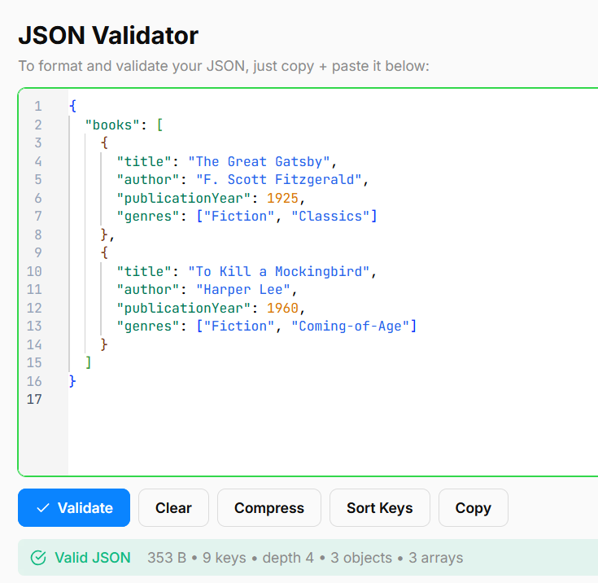
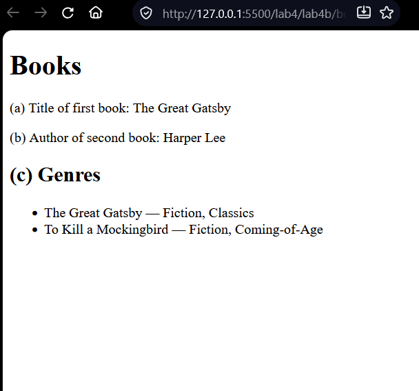
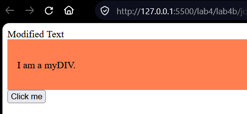

# Lab 4b: JSON and jQuery (BIC21203 Web Development)
 
## Files
- `books.json`: dataset (top-level `books` array, 2 books)
- `books.html`: loads `books.json` with `fetch()` and displays results
- `jquery-dom.html`: jQuery 4.0.0 (full build, CDN) DOM and event demo
## Setup
1. Clone this repo and open the folder in VS Code.
2. Install the **Live Server** extension, right-click `books.html` > *Open with Live Server*.
   (Do not open `books.html` via `file://`; `fetch()` will fail.)
3. `jquery-dom.html` needs internet access for the jQuery CDN.
## Screenshots

 
